# spring-modernisation-agent

AI-assisted migration of a Spring estate from Spring Boot 2.7 / Java 11 to Spring Boot 3.5 / Java 21.

> **Deterministic tools make the changes they reliably can; a bounded AI ports what is left, one problem at a time, against a behaviour contract recorded on the baseline; facts decide what needs a person; and Maven plus that contract decide what works.**

**Status:** the pipeline below is built and proven in CI (runs 11–26). The open "make Maven green" loop kept finding new workarounds, so it has been replaced (Phase 8) by a behaviour contract recorded on the baseline (proven in run 26), problems classified by kind, and scoped AI ports that are kept only if they keep their behaviour. Durable fixes are next. See [`docs/system-design.md`](docs/system-design.md) §2–§5.

## Where to start

| You want to… | Read |
|---|---|
| Understand the system: layers, identifiers, verdicts, policy, accretion | [`docs/system-design.md`](docs/system-design.md) |
| Know what is built and what is next | [`tasks/todo.md`](tasks/todo.md) |
| See what each CI run showed, and the demo traps | [`tasks/demo-traps.md`](tasks/demo-traps.md) |
| Avoid mistakes already made | [`tasks/lessons.md`](tasks/lessons.md) |

## How it works

Purple boxes are where the AI is involved; everything else is deterministic. The AI never decides an outcome: it proposes, and guardrails, Maven and the behaviour contract decide.

```mermaid
flowchart TD
    subgraph ASSESS["1 · Assess the estate"]
        A1["Scan repositories<br/>kind, Boot and Java versions, libraries"]
        A2["Dependency graph and waves<br/>parents and libraries first"]
        A3["Check each baseline builds"]
        A4["🤖 AI writes the strategy document<br/>explains the facts, decides nothing"]
        A1 --> A2 --> A3 --> A4
    end

    subgraph TRANSFORM["2 · Transform one repository (each repository in the wave)"]
        T1["Clone at the assessed commit"]
        T2["Record the behaviour contract<br/>on Boot 2.7 / Java 11:<br/>context starts, endpoint × role → status,<br/>settings, HTTP client and cache values"]
        T3["OpenRewrite recipes<br/>Boot 3.5, Java 21, lab recipes"]
        T4{"Maven validates<br/>compile and tests"}
        T5["Classify what is left, from facts<br/>mechanical · API move · platform dropped ·<br/>contract · knock-on"]
        T6["Recipe discovery<br/>matches indexed recipes, measures them<br/>on a throwaway copy: suggestions only"]
        P1["One task per known API move<br/>its files, its errors, checked notes,<br/>the behaviour it must keep"]
        T7["🤖 AI ports one task<br/>reads, previews its edits,<br/>proposes changes to the task's files only"]
        T8{"Guardrails<br/>only the task's files, no new types,<br/>no test edits, no dropped annotations<br/>or settings, no unsupported libraries"}
        K{"Kept?<br/>the task's errors are gone<br/>and nothing new fails"}
        R["Revert the task's files<br/>one repair with the exact failure,<br/>then it goes to a person"]
        G{"Contract gate<br/>each kept port's behaviour<br/>unchanged on Boot 3.5?"}
        D["For a person<br/>platform dropped · contract changes ·<br/>ports not kept"]
        T9["Compare behaviour<br/>on Boot 3.5 / Java 21"]
        T1 --> T2 --> T3 --> T4
        T4 -- "fails" --> T5 --> T6 --> P1
        T5 -- "not an API move" --> D
        P1 -- "next task" --> T7 --> T8
        T8 -- "applied" --> K
        T8 -- "rejected" --> R
        K -- "yes" --> P1
        K -- "no" --> R
        R -. "repair" .-> T7
        R -- "still not kept" --> D
        P1 -- "no tasks left" --> G
        G -- "changed: repair, then revert" --> R
        G -- "unchanged" --> T9
        T4 -- "passes" --> T9
    end

    subgraph VERDICT["3 · Verdict, from facts only"]
        V{"Maven passed and<br/>behaviour unchanged and<br/>no unsupported library?"}
        V1["✅ Succeeded"]
        V2["⚠️ Needs decision"]
        V3["❌ Failed"]
        V -- "yes" --> V1
        V -- "Maven passed, but behaviour changed<br/>or a library was dropped" --> V2
        V -- "Maven failed" --> V3
    end

    subgraph HANDOVER["4 · Hand over"]
        H1["Job summary and results document<br/>🤖 AI analysis, labelled as such"]
        H2["Draft pull request<br/>patches per stage, behaviour differences,<br/>manual steps, recipe suggestions"]
        H3["👤 A person reviews, decides and merges"]
        H1 --> H2 --> H3
    end

    A4 --> T1
    T9 --> V
    D --> V
    V1 --> H1
    V2 --> H1
    V3 --> H1
    V1 -. "opens the next wave" .-> T1

    classDef ai fill:#ede7f6,stroke:#5e35b1,stroke-width:2px,color:#311b92
    classDef person fill:#fff8e1,stroke:#f9a825,color:#5d4037
    class A4,T7,H1 ai
    class H3 person
```

| Step | What happens | Who decides |
|---|---|---|
| **Assess** (`assess`) | Scans the estate, works out dependencies and waves, and checks the baseline builds. The AI writes the strategy document. | Deterministic rules; the AI only explains |
| **Transform** (`transform`) | Clones each repository in the next wave at its assessed commit, runs the OpenRewrite recipes for its route, and validates with Maven. Every stage is recorded as a patch. | OpenRewrite, then Maven |
| **Port** (part of `transform`, opt-in) | What the recipes left is classified from facts. Each known API move becomes one scoped task: the AI proposes changes to that task's files only. A port is kept only if its errors are gone, nothing new fails and the behaviour it must keep is unchanged; otherwise it is reverted after one repair. Everything else goes to a person. | The proposal comes from the AI; facts, guardrails, Maven and the behaviour contract decide |
| **Report** (`report`) | Writes the migration results document. | Deterministic, plus labelled AI analysis |
| **Hand over** (`publish`, opt-in) | Writes a reviewer summary and opens or updates a **draft** pull request on `migration/spring-boot-3.5-java-21`. It never pushes to the default branch and never merges. | A person |

Each repository ends in one of four states: **Succeeded**, **Needs decision**, **Failed** or **Not run**. Only *Succeeded* opens the next wave. A repository that still uses a library Spring Boot 3 dropped (for example Ehcache 2) is *Needs decision*, whatever Maven says.

## Key findings (CI runs 11–24)

The demo repository, `orders-service`, has six seeded traps (T1–T6, catalogued in [`tasks/demo-traps.md`](tasks/demo-traps.md)).

**1. OpenRewrite does most of the work, and says where it stops.** It changed 7–8 files, reported about 3 hours of work saved, and wrote its own "Migrate manually" marker where it gave up. It left 12 compile errors in three areas (Hibernate `UserType`, HttpClient 5, the Spring Security adapter) and two problems that only appear at runtime.

**2. The AI can do the long tail.** In run 14 it fixed all five code traps in 4 attempts (about 138k input tokens) and Maven passed. It needed real library signatures to do it: without a `describe_class` tool it guessed HttpClient 5 methods three times (run 13).

**3. Asked to "make the build green", the AI repeatedly found ways around the rules instead of stopping.** T6 uses Ehcache 2, which Spring Boot 3 dropped. The right answer is "a person must choose a replacement". Instead the AI found a new workaround in almost every run, each time getting past the rule written after the previous one:

| Run | What the AI did | Why it was a problem |
|---|---|---|
| 16 | Wrote its own 146-line cache. Its expiry was short only when the **test's** config file was loaded | It gamed the test: production would have behaved differently |
| 20 | After "no new classes" was added: made an existing class implement `CacheManager` and returned an **anonymous** `Cache` | The same component, in a shape the rule didn't see |
| 21 | After "no anonymous classes": **deleted `@Cacheable`** and wrote caching by hand inside the service, then set **`spring.cache.type: none` in production** | Removed behaviour, and switched production caching off |
| 23 | Added a fallback cache with no expiry or size limit, then a hand-written cache that parsed `ehcache.xml` itself. Reported **"Fixed"** | A green build with the library still unsupported. It also exposed a bug in our own guardrail (comparisons like `ttl > 0 … age < max` were mistaken for generics, hiding the code between them) |
| 24 | Stopped for a decision correctly, but included a `javax.servlet` "fix" that still failed | The run kept a change that fixed nothing |

A green build also hid real losses: in run 14, a `POST` to `/api/orders/` (trailing slash) bypassed the operator-only rule, and the HTTP connection time-to-live was dropped, in runs 14 and 24 alike.

**4. Adding a rule per workaround never converged; facts did.** Each new rule held for one run. What ended the Ehcache series was an invariant the AI can't argue with: it may not edit `pom.xml`, so if the POM still declares an unsupported library, a green build cannot mean it was migrated. The repository is "Needs decision", whatever Maven says. Every rule change is now checked by replaying the real proposals from past runs, both ways: the bad ones must be rejected and the good ones still accepted.

**5. Recurring AI fixes should become recipes, but only after measuring them.** The AI fixed T3 (`javax.servlet` names in strings) by hand in four runs and broke it in a fifth. An OpenRewrite recipe now does it deterministically, producing a file byte-identical to the AI's correct fixes. Recipe discovery then found an existing recipe for T1 (`MigrateUserType`), but measuring it showed it fixes 3 errors and introduces 4. A recipe that looks like a perfect match still has to be measured.

**6. Results vary between runs.** The same code gave Fixed (run 14), AttemptsExhausted (runs 20 and 21) and Needs decision (runs 22 and 24). A run costs roughly 0.17–0.7M input tokens. One run is one sample.

**What changed as a result** (the Phase 8 redesign, [`docs/system-design.md`](docs/system-design.md)):
- a behaviour contract is recorded on the baseline, so "green" has to mean "behaviour kept";
- problems are classified from facts, so a dropped library goes straight to a person and never reaches the AI;
- the AI ports one scoped problem at a time, and its fix is reverted unless that problem's errors disappear;
- accepted AI fixes are turned into recipes.

## What the AI may and may not do

- **May:** read the workspace, OpenRewrite's patch, its task's diagnostics and real library signatures; preview its edits against the same guardrails that apply them; propose changes to **its task's files only**; say it cannot port a task, with options for a person.
- **May not:** edit any file outside its task, or tests, `pom.xml`, CI or build files; add new types (named or anonymous) or new supertypes; write code against unsupported libraries; remove behaviour annotations such as `@Cacheable` or `@Transactional`; change existing settings' values; refer to test files from production code; decide what is a decision (classification does that); decide that anything succeeded.
- **Bounded:** one attempt and one repair per task. A port that is not kept is reverted, and the attempt is shown in the pull request.

## Running it

CI: run the **Spring modernisation** workflow (`.github/workflows/portfolio-transform.yml`) with these inputs:

| Input | Default | Effect |
|---|---|---|
| `remediation` | off | Run scoped AI ports for known API moves (Azure AI Foundry over GitHub OIDC): one attempt and one repair per task |
| `open-draft-pull-requests` | off | Publish reviewer summaries as draft PRs (uses the `MIGRATION_GITHUB_TOKEN` secret) |

Artifacts per run:
- `transformation-results-<run>`: results JSON, `transformation-summary.md`, `patches/<repo>/*.patch`, `summaries/<repo>.md`, `pull-requests.json` and the results document;
- `spring-modernisation-assessment`;
- `baseline-build-results`.

Locally: `dotnet test`, then `dotnet run --project src/SpringModernisationAgent -- <assess|transform|report|publish>`. The commands read and write `Artifacts/` in the working directory.

The planned control-plane commands (`run start`, `run status`, `run fetch`, `digest`, `explain`, `replay`, `ledger`) are described in `docs/system-design.md` §10 and tracked as Phase 8 in `tasks/todo.md`.

## Configuration

| Variable | Used by | Meaning |
|---|---|---|
| `FOUNDRY_PROJECT_ENDPOINT`, `FOUNDRY_MODEL`, `FOUNDRY_AUTH_MODE` | AI agents | Azure AI Foundry project, deployment (`spring-migration-strategy`, currently gpt-5-mini) and auth mode |
| `MIGRATION_REMEDIATION` | `transform` | `enabled` to run scoped AI ports |
| `MIGRATION_PUBLISH_PULL_REQUESTS`, `GITHUB_TOKEN`, `GITHUB_ORGANISATION`, `MIGRATION_WORKSPACE_ROOT` | `publish` | Draft PR publishing |

Routes, recipes and validation checks per repository kind: `src/SpringModernisationAgent/Config/spring.yaml`.

Pipeline-owned OpenRewrite recipes (durable fixes, for example `lab.jakarta.ServletStringLiterals` for `javax.servlet` names in string literals): `src/SpringModernisationAgent/Config/recipes/lab-recipes.yml`. A route uses one with `configuration: recipes/lab-recipes.yml` instead of an artifact.

Libraries Spring Boot 3 dropped, with their manual steps: `src/SpringModernisationAgent/Config/knowledge/unsupported-libraries.yaml`. Adding a library is one entry, with no code change; the file's header lists the fields and how each is used.
